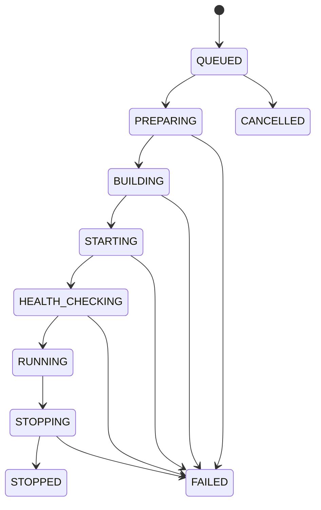

# Deployment State Machine

## 1. Statuses

| Status | Meaning | Terminal? |
|---|---|---|
| `QUEUED` | Request accepted and waiting for worker | No |
| `PREPARING` | Worker validates and prepares node/workspace | No |
| `BUILDING` | BuildKit is building the image | No |
| `STARTING` | Container is being created/started | No |
| `HEALTH_CHECKING` | Application health is being checked | No |
| `RUNNING` | Deployment is healthy and routed | Yes for this deployment attempt |
| `STOPPING` | Stop operation is in progress | No |
| `STOPPED` | Container is stopped | Yes |
| `FAILED` | Operation failed | Yes |
| `CANCELLED` | Request cancelled before execution | Yes |

`RUNNING`, `STOPPED`, `FAILED` and `CANCELLED` are terminal for an individual deployment attempt. A restart or redeploy creates a new deployment attempt; the old attempt remains auditable and is never silently rewritten. At most one deployment per application may be `RUNNING`.

## 2. Normal transition

## 3. Transition rules

- Only the worker/orchestrator changes execution states after a user request is accepted.
- API may request cancellation/stop, but must not directly mark a deployment `STOPPED`.
- Every transition records timestamp and deployment ID; audit important user-initiated actions.
- Illegal transitions are rejected and logged.
- Repeated job delivery must be idempotent.
- `FAILED` must include a stable error code and sanitized diagnostic; never include secret values.
- A deployment must not become `RUNNING` until its container is healthy and its route configuration is active.
- The default update strategy is build-and-health-check the new attempt alongside the current
  deployment, then replace it. Stop-first is allowed only when resource limits require it; the
  expected downtime must be recorded in the deployment log and surfaced in the API response.
- `POST /deployments/:id/restart` creates a new attempt; it does not reset the old attempt to
  `QUEUED` or rewrite its timestamps.
- Archiving an application is blocked while any deployment is active (`QUEUED` through
  `HEALTH_CHECKING`, or `RUNNING`) and returns `409 INVALID_STATE`.

## 4. Retry and recovery

Retry is allowed only for explicitly classified transient failures. A retry must not create duplicate containers or routes. On worker restart, inspect persisted status and runtime state before resuming. If safe recovery cannot be proven, mark the attempt failed with a recoverable diagnostic and require a new deployment request.

## 5. Frontend mapping

Frontend status badges, timeline and action availability must use these exact statuses. Do not invent frontend-only lifecycle statuses. Display a human-readable label while preserving the API enum value internally.
