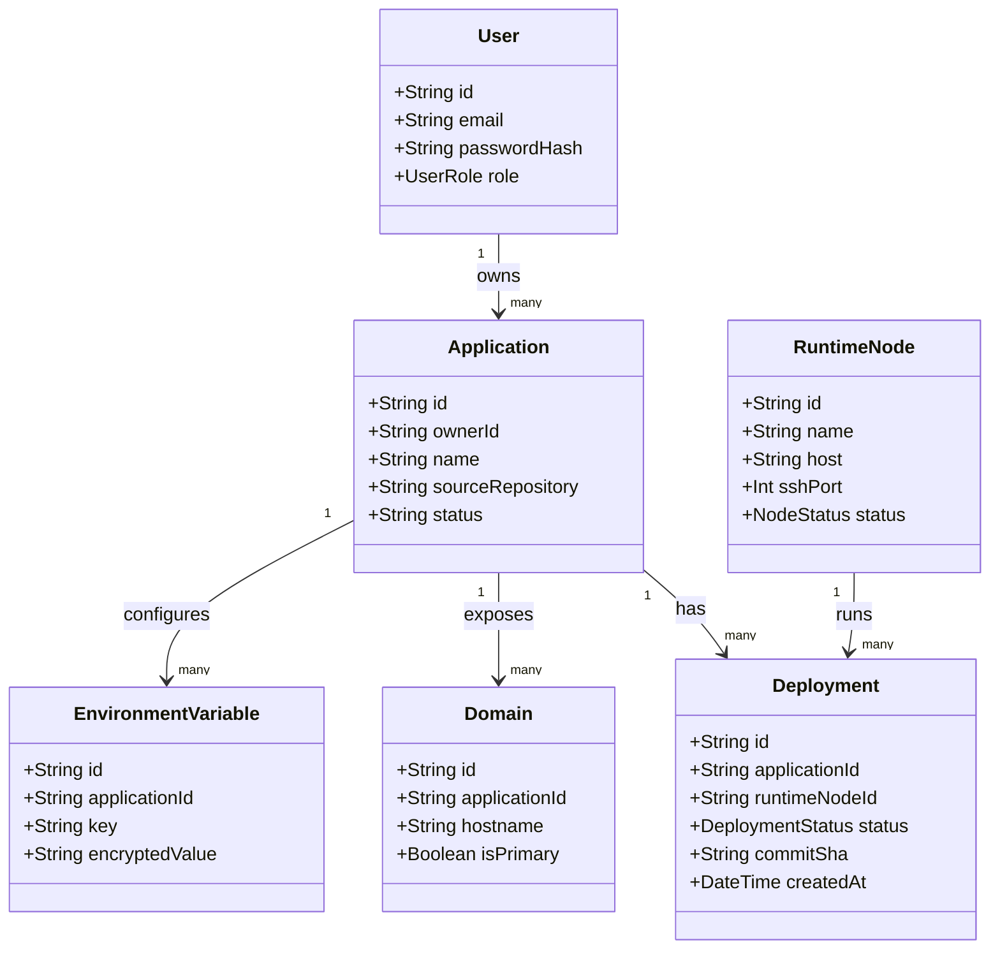

# Class and Module Design

## 1. Design rules

This is a proposed baseline design for the MVP, not a requirement to turn every file into a class. Use classes for adapters or services that benefit from dependency injection/state; pure transformations and simple use cases may be functions. Keep interfaces explicit at module boundaries.

## 2. Core domain model



## 3. Application service boundaries

| Component | Main operations | Must not do |
|---|---|---|
| `AuthService` | register, authenticate, revoke session | Handle HTTP response objects |
| `SessionService` | issue, validate, revoke and expire sessions; store only hashes | Return the raw session token to any layer above the HTTP response |
| `ApplicationService` | create, update, list, archive; verify owner | Run Docker or SSH commands |
| `DeploymentService` | validate deploy request, create deployment record, enqueue job, request stop/restart | Execute long build synchronously |
| `NodeService` | list nodes, read health/capacity, mark health observations | Provision Proxmox VMs in MVP |
| `DomainService` | validate hostname, associate/release domain | Change live Cloudflare DNS directly |
| `EnvironmentVariableService` | encrypt, store, rotate, delete values | Return plaintext values in normal API responses |
| `AuditService` | append security/action events | Store passwords or secret values |
| `DeploymentLogService` | append redacted build output within the size cap, read bounded pages | Persist runtime container stdout or unredacted values |

## 4. Worker use cases and adapters

| Component | Main operations | Boundary |
|---|---|---|
| `DeploymentProcessor` | Validate job payload and dispatch operation | BullMQ processor; no HTTP dependency |
| `NodeScheduler` | Choose healthy node with sufficient reported capacity | Deterministic policy; no Proxmox API |
| `BuildService` | Prepare isolated workspace and invoke build | One active build at a time in MVP |
| `DeploymentOrchestrator` | Coordinate build, start, health-check and route update | Drives state transitions |
| `DockerAdapter` | Build/run/stop/restart/inspect container using constrained operations | No arbitrary user-provided CLI |
| `BuildKitAdapter` | Invoke approved BuildKit build workflow | Enforce timeout/resource/workspace limits |
| `SshAdapter` | Connect to an allowlisted runtime node through a forced-command helper and invoke a fixed verb with a JSON payload | No generic command endpoint, no shell strings |
| `TraefikConfigAdapter` | Write validated dynamic routing configuration | Does not manage Cloudflare account |
| `LogRedactionService` | Mask environment values, tokens and secret patterns before persistence or response | Decide authorization |

## 5. Suggested method contracts

These are conceptual TypeScript signatures. Adapt names only through team review.

```ts
interface ApplicationService {
  create(userId: string, input: CreateApplicationInput): Promise<Application>;
  listOwned(userId: string): Promise<Application[]>;
  getOwned(userId: string, applicationId: string): Promise<Application>;
  updateOwned(userId: string, applicationId: string, input: UpdateApplicationInput): Promise<Application>;
}

interface DeploymentService {
  requestDeploy(userId: string, applicationId: string, input: DeployInput): Promise<Deployment>;
  getOwned(userId: string, deploymentId: string): Promise<Deployment>;
  requestStop(userId: string, deploymentId: string): Promise<void>;
  requestRestart(userId: string, deploymentId: string): Promise<void>;
}

interface NodeScheduler {
  selectNode(requirements: ResourceRequirements): Promise<RuntimeNode>;
}

interface DeploymentOrchestrator {
  execute(deploymentId: string): Promise<void>;
  stop(deploymentId: string): Promise<void>;
}
```

## 6. Ownership and dependency

- Backend 1 owns API/domain services, Prisma models and repository contracts.
- Backend 2 owns worker orchestration and runtime adapters.
- Backend 1 and Backend 2 jointly review shared deployment types and state transitions.
- Frontend consumes API DTOs; it does not import backend implementation classes.
- IAAS supplies the verified node access contract; backend worker must not assume unrestricted SSH.

## 7. Change control

Before adding a new domain service, class or abstraction, state the business responsibility it owns. Avoid duplicate sources of truth (for example, deployment status must be governed by one state-transition policy).
