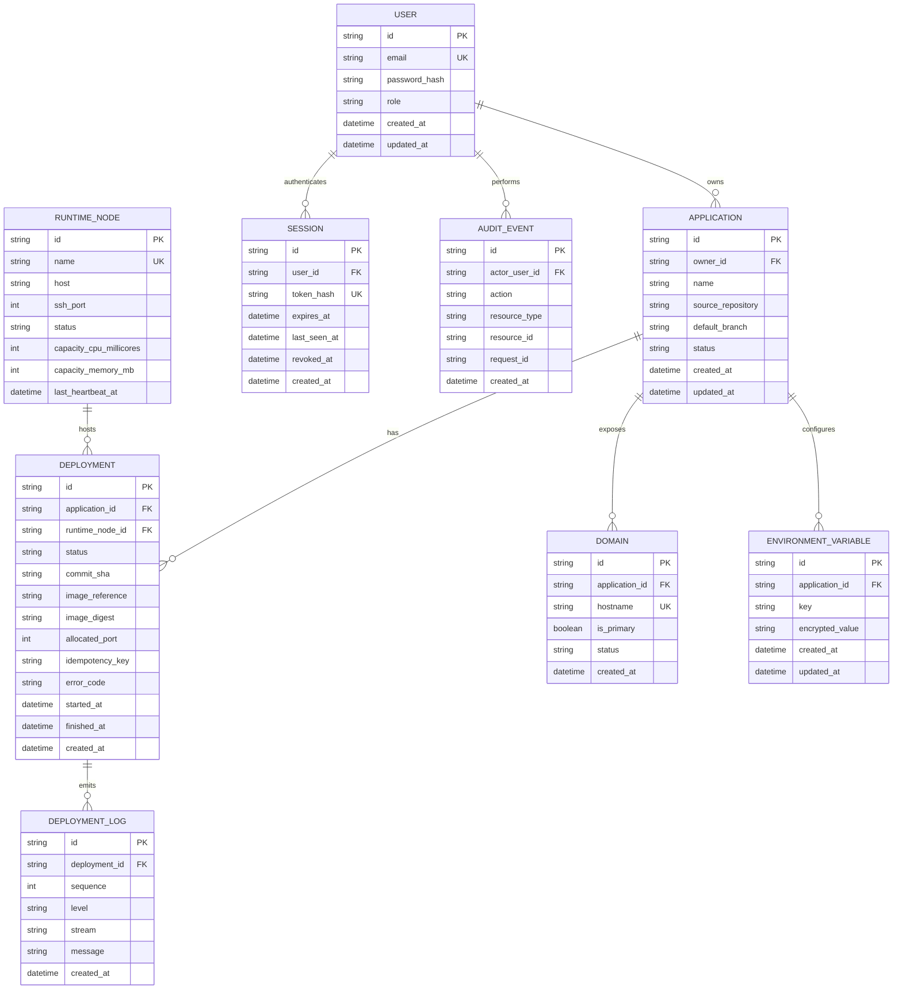

# Database ERD and Data Relationships

## 1. Scope

This document defines the initial relational model for the academic MVP. It is a logical design to be translated into and reviewed as a Prisma schema. Exact SQL types, indexes and migration details are finalized during initialization.

## 2. ERD

Column names above are the physical `snake_case` names. TypeScript and API JSON use `camelCase`
(`sourceRepository`, `defaultBranch`, `imageDigest`, `idempotencyKey`). Prisma models declare the
camelCase field and map it with `@map`, so there is exactly one translation rule.

## 3. Entity rules

- `User.email` is unique and normalized before persistence.
- `Session.tokenHash` stores a SHA-256 hash of the opaque cookie token. The raw token never
  round-trips to the database. A session is valid only while `revokedAt` is null, `expiresAt` is in
  the future and `lastSeenAt` is within the idle window.
- `Application.ownerId` is mandatory. Every application query/mutation must include ownership authorization.
- `Application.status` is `ARCHIVED` for soft-deleted records; deletion never hard-removes deployment
  history.
- `Deployment` belongs to one application and may reference a selected runtime node. A deployment record remains as history after later deployments.
- `Deployment.imageDigest` is immutable once set; `imageReference` is the node-local tag used for
  rollback. Neither is exposed through the API in the MVP.
- `Deployment.idempotencyKey` is supplied by the client. `(applicationId, idempotencyKey)` is unique so
  a repeated request resolves to the existing deployment instead of creating a second release.
- `Deployment.allocatedPort` is unique per runtime node while the deployment is active, and always
  falls in `30000-32767`.
- `DeploymentLog` stores redacted text only, capped at 2000 lines or 200 KB per deployment, with a
  unique `(deploymentId, sequence)` ordering.
- `RuntimeNode` stores inventory and last-known health/capacity; it is not a live guarantee of available resources.
- `Domain.hostname` is globally unique within this PaaS installation.
- `EnvironmentVariable` key is unique per application (composite unique constraint).
- `encryptedValue` contains AES-256-GCM ciphertext in the form `v1:<iv>:<tag>:<ciphertext>`.
  Encryption keys are stored outside the database and repository.
- `AuditEvent.actorUserId` is nullable because a failed login has no authenticated actor.
  `AuditEvent` must not store password, token or environment-variable plaintext.

## 4. Recommended indexes and constraints

- Unique: `User.email`, `RuntimeNode.name`, `Domain.hostname`, `Session.tokenHash`.
- Composite unique: `EnvironmentVariable(applicationId, key)`.
- Composite unique: `Deployment(applicationId, idempotencyKey)`.
- Composite unique: `Deployment(runtimeNodeId, allocatedPort)`, used to guarantee one container per
  published host port. Rows with a null node or port are excluded by the database's null handling and
  are acceptable because a deployment has no runtime port before it starts.
- Composite unique: `DeploymentLog(deploymentId, sequence)`.
- Index: `Application(ownerId, createdAt)`.
- Index: `Deployment(applicationId, createdAt)`.
- Index: `Deployment(runtimeNodeId, status)`.
- Index: `Session(userId, expiresAt)`.
- Index: `AuditEvent(actorUserId, createdAt)`.
- Foreign keys use restrictive or cascading behavior deliberately; deleting an application should not silently erase deployment audit history. Prefer archive/soft-delete semantics for application records in the MVP.

## 5. Enum candidates

Decided: use Prisma enums for the following, and verify the choice by running `prisma validate`
plus one migration against a throwaway local MariaDB 11.4 container during initialization.

- `UserRole`: `USER`, `ADMIN`.
- `ApplicationStatus`: `ACTIVE`, `ARCHIVED`.
- `NodeStatus`: `ONLINE`, `DEGRADED`, `OFFLINE`, `MAINTENANCE`.
- `DeploymentStatus`: see `deployment-state-machine.md`.
- `DomainStatus`: `PENDING`, `ACTIVE`, `FAILED`, `DISABLED`.

If a native enum cannot be created for the selected Prisma/MariaDB combination, fall back to
validated string columns whose values come from a Zod enum exported by `shared/types/`. Record the
outcome in `docs/design/decisions.md` before continuing.

## 6. Deliberate MVP omissions

Do not add billing, organization/team tenancy, registry credentials, autoscaling policies or Proxmox
VM provisioning tables unless product scope is approved. The MVP stores no source-control
credentials: only public HTTPS repositories are supported, so there is no token or deploy-key table.
Never store raw tokens.
